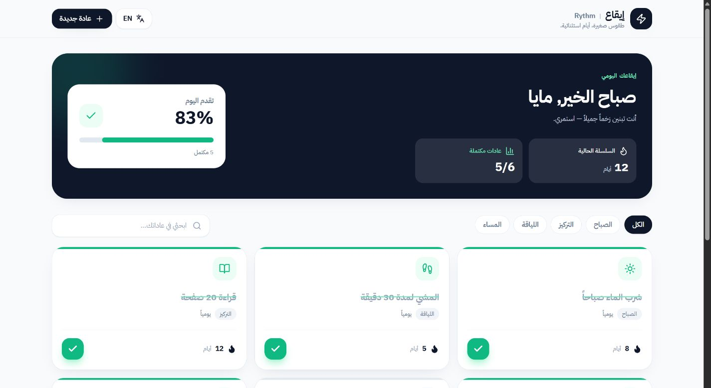

# Rythm Habit Tracker | إيقاع لتتبّع العادات

A calm habit-tracking interface for organizing routines and visualizing daily progress. Users can create, categorize, search, and complete habits, with locally saved state and a bilingual overview of consistency and weekly activity.

[Live demo](https://eng-ayatnassar.github.io/rythm-habit-tracker/) · [Source code](https://github.com/eng-ayatnassar/rythm-habit-tracker) · [Ayat Nassar's portfolio](https://eng-ayatnassar.github.io/)



## Overview

Designed and developed by **Ayat Nassar** as a bilingual front-end portfolio project. The interface supports English and Arabic RTL, responsive layouts, and practical client-side interactions.

## Features

- Create, categorize, search and delete habits
- Completion controls and daily progress indicators
- Illustrative streaks and weekly consistency view
- Local persistence, Arabic/English and responsive feedback

## Tech stack

React · JavaScript · Tailwind CSS · Vite

## Run locally

Requires **Node.js 22.12 or newer**.

```bash
npm ci
npm run dev
```

On Windows, you can also run `start.cmd`.

## Production build

```bash
npm run build
npm run preview
```

The build is written to `dist/`. Relative asset paths support deployment under a GitHub Pages repository path.

## Demo scope

**Frontend Demo.** Browser-local frontend demo with illustrative streak/week counters. No accounts, device sync, or independent daily rollover service is implemented. Use fictional input when trying forms. External imagery and fonts depend on their providers.

## Deployment

The GitHub Actions workflow installs locked dependencies, checks known high-severity advisories, builds, and deploys to GitHub Pages on pushes to `main`. Pull requests run the build without deployment. Repository Pages settings use **GitHub Actions** as the source.

Source, lockfiles, and preview images are tracked. `node_modules/`, `dist/`, secrets, and local logs are excluded.

## بالعربية

واجهة هادئة لتنظيم الروتين ومتابعة الإنجاز اليومي، تتيح إنشاء العادات وتصنيفها والبحث فيها وتحديد اكتمالها، مع حفظ البيانات محلياً وعرض مؤشرات الاستمرارية والنشاط الأسبوعي باللغتين.

- إنشاء العادات وتصنيفها والبحث فيها وحذفها
- تحديد الاكتمال ومؤشرات الإنجاز اليومي
- عرض توضيحي للسلاسل والنشاط الأسبوعي
- حفظ محلي وعربية وإنجليزية وتنبيهات متجاوبة

هذا المشروع عرض Frontend لمعرض الأعمال، وليس خدمة تجارية متصلة بخادم أو نظام دفع أو حسابات حقيقية.
